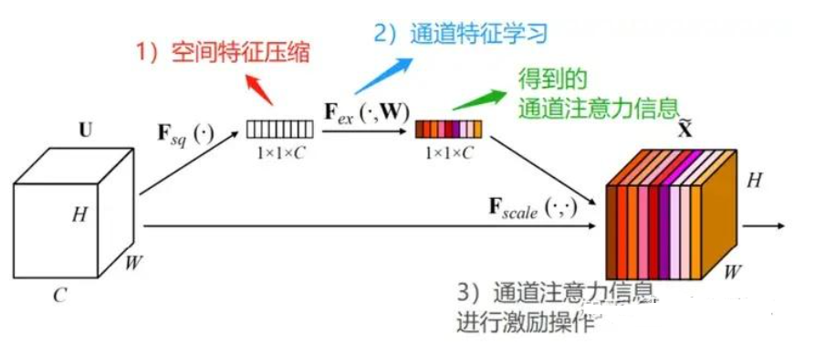
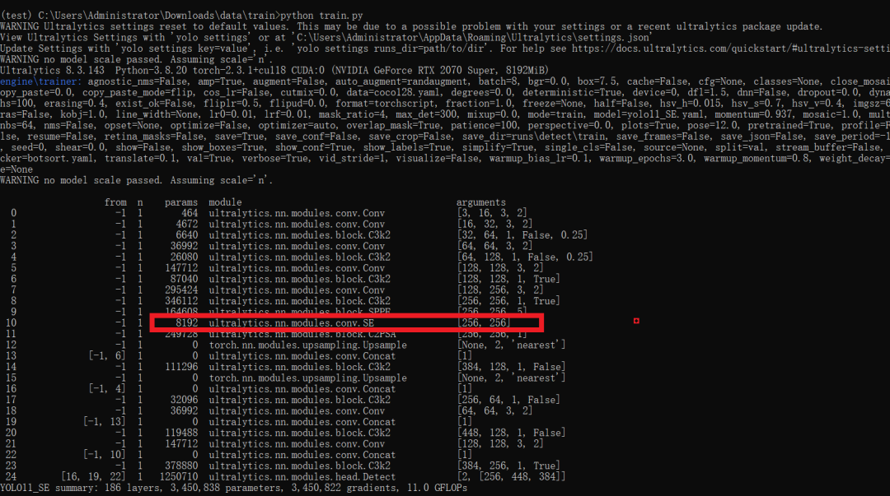

# [yolov11 Improvement Series] YOLOv11 with SE Attention Mechanism Python Source Code + Training Source Code + Improvement Principles + Improvement Process

[SE Attention Mechanism Introduction] SENet was the champion of the ImageNet competition in 2017 and the most cited paper in CVPR in 2018.

[SE Attention Mechanism Introduction]

SENet is the champion of the 2017 ImageNet competition and the most cited paper in the 2018 CVPR. The paper can be found here: [SENet](Squeeze-and-Excitation Networks). The main idea behind SENet is to enhance the model's performance by compressing and exciting the input features. Specifically, the SE attention mechanism consists of two steps: squeeze and excitation. In the squeeze step, global average pooling is used to compress the input feature map into a vector, which is then mapped to a smaller vector through a fully connected layer. In the excitation step, each element in the vector is compressed to the range of 0 to 1 using a sigmoid function, and then multiplied with the original input feature map to obtain the weighted feature map. The SE attention module is a channel attention module that can strengthen the channel features of the input feature map without changing its size.

 Edit

Before the SE module is implemented, the dimensions of the feature map are H*W*C.

1.

1.

First, spatial feature compression is performed on the feature map, and global average pooling is implemented in the spatial dimension to obtain a 1x1xC feature map.

1.

1.

Through the FC fully connected layer learning, we obtain the feature map with channel attention, and its dimension is still 1*1*C.

1.

1.

Performs channel-wise multiplication of the feature maps of 1*1*C channels and the original input H*W*C feature maps, ultimately outputting the feature map with channel attention.

[Introduction to YOLOv11 Framework]

On September 30, 2024, Ultralytics officially released YOLOv11 during its event YOLOVision. YOLOv11 is the latest version of YOLO, developed by the team from both the United States and Spain, Ultralytics. YOLO stands for You Only Look Once, a computer vision algorithm used in image-based artificial intelligence.

### Ultralytics YOLO11 Overview

YOLO11 is the latest version of the Ultralytics YOLO series of real-time object detectors, redefining possibilities with cutting-edge precision, speed, and efficiency. Building on impressive advancements from previous YOLO versions, YOLO11 introduces significant improvements in architecture and training methods, making it a versatile choice for various computer vision tasks.


Editor

Key Features

-

-

Enhanced feature extraction: YOLO11 employs an improved backbone and neck architecture, enhancing feature extraction capabilities to achieve more precise object detection and complex task performance.

-

-

Optimization for efficiency and speed: YOLO11 introduces refined architecture design and optimized training pipelines, providing faster processing speeds while maintaining the best balance between accuracy and performance.

-

-

Achieving higher accuracy with fewer parameters: With the advancement of model design, YOLOv11m has achieved higher average precision (mAP) on the COCO dataset while using 22% fewer parameters than YOLOv8m, thereby improving computational efficiency without compromising accuracy.

-

-

Cross-environment adaptability: YOLO11 can be seamlessly deployed in various environments, including edge devices, cloud platforms, and systems supporting NVIDIA GPUs, ensuring maximum flexibility.

-

-

Supports a wide range of tasks: whether it's object detection, instance segmentation, image classification, pose estimation, or Oriented Object Detection (OBB), YOLO11 aims to tackle various computer vision challenges.


Editor

#### Compared to previous versions, what are the key improvements in Ultralytics YOLO11?

Ultralytics YOLO11 introduces several significant improvements compared to its predecessor. The main improvements include:

-

-

Enhanced feature extraction: YOLO11 employs an improved backbone and neck architecture, enhancing feature extraction capabilities to achieve more precise object detection.

-

-

Optimized efficiency and speed: Precise architectural design and optimized training pipelines provide faster processing speeds while maintaining a balance between accuracy and performance.

-

-

Achieving higher accuracy with fewer parameters: YOLOv11m achieves higher average precision (mAP) on the COCO dataset, reducing its parameters by 22% compared to YOLOv8m, while improving computational efficiency without compromising accuracy.

-

-

Cross-environment adaptability: YOLO11 can be deployed across various environments, including edge devices, cloud platforms, and systems supporting NVIDIA GPUs.

-

-

Supports a wide range of tasks: YOLO11 supports various computer vision tasks, such as object detection, instance segmentation, image classification, pose estimation, and Oriented Object Detection (OBB).

[Test Environment]

windows10 x64

ultralytics==8.3.143

torch==2.3.1

[Improvement Process]

#### 1. SE Attention Mechanism Code (For the core module source code, please refer to the improvement steps.docx)

#### 2. File modification steps

Step 1: Modify the conv.py file

1.

1.

Locate the file: Find `ultralytics/nn/modules/conv.py` in the project directory.

1.

1.

Execute modification:

-

-

Add the "SE" identifier to the module export list `__all__`

-

-

Insert the complete implementation of SE attention mechanism at the end of the file.

-

**Step 2: Modify the __init__.py file**

1.

1.

Locate the file: Find `ultralytics/nn/modules/__init__.py` in the project directory.

1.

1.

Execute modification:

-

-

Add `SE` class reference in the import statement

-

-

Synchronously add the "SE" identifier to the module export list `__all__`

-

**Step 3: Modify the tasks.py file**

1.

1.

Locate the file: Find `ultralytics/nn/tasks.py` in the project directory.

1.

1.

Execute modification:

-

-

Add SE module processing logic to the model parsing function `parse_model`.

-

-

The specific location can be quickly located by searching the `def parse_model` function.

-

Step 4: Create the model configuration file

1.

1.

Create a new file: Create `yolo11_SE.yaml` in the model configuration directory.

1.

1.

File configuration:

-

-

Copy the content of the standard yolo11.yaml file.

-

-

Insert SE module configuration into the network structure definition section.

-

-

Maintain other training parameters consistent with the original configuration.

-

#### 3. Verification of integration

Start training tasks using the newly created yaml configuration file:

```
from ultralytics import YOLO
if __name__ == '__main__':
    model = YOLO('yolo11_SE.yaml')  # build from YAML and transfer weights
        # Train the model
    results = model.train(data='coco128.yaml',epochs=100, imgsz=640, batch=8, device=0, workers=1, save=True,resume=False)
```

After successful integration, the training log will show the initialization information of the SE module, indicating that the attention mechanism has been correctly loaded into the model.

 Edit

Note: When implementing, please adjust the file path according to the specific directory structure of the project and ensure that the number of channels in the SE module matches the context network layer.

[Training Instructions]

Step 1: First, install the necessary modules for YOLOv11. You can refer to the installation process of the YOLOv11 framework. Then, uninstall the official version of pip by running `pip uninstall ultralytics`. Finally, install the improved source code by running `pip install .`
Step 2: Place your dataset in a folder named 'dataset' and ensure that the folder names do not change.
Step 3: Open train.py and modify the necessary parameters. Finally, execute `python train.py` to train.

[Provided Files]

```
├── [Official Version]ultralytics-8.3.143.zip
├── train/
│   ├── coco128.yaml
│   ├── dataset/
│   │   ├── train/
│   │   │   ├── images/
│   │   │   │   ├── firc_pic_1.jpg
│   │   │   │   ├── firc_pic_10.jpg
│   │   │   │   ├── firc_pic_11.jpg
│   │   │   │   ├── firc_pic_12.jpg
│   │   │   │   ├── firc_pic_13.jpg
│   │   │   ├── labels/
│   │   │   │   ├── classes.txt
│   │   │   │   ├── firc_pic_1.txt
│   │   │   │   ├── firc_pic_10.txt
│   │   │   │   ├── firc_pic_11.txt
│   │   │   │   ├── firc_pic_12.txt
│   │   │   │   ├── firc_pic_13.txt
│   │   │   └── labels.cache
│   │   └── val/
│   │       ├── images/
│   │       │   ├── firc_pic_100.jpg
│   │       │   ├── firc_pic_81.jpg
│   │       │   ├── firc_pic_82.jpg
│   │       │   ├── firc_pic_83.jpg
│   │       │   ├── firc_pic_84.jpg
│   │       ├── labels/
│   │       │   ├── firc_pic_100.txt
│   │       │   ├── firc_pic_81.txt
│   │       │   ├── firc_pic_82.txt
│   │       │   ├── firc_pic_83.txt
│   │       │   ├── firc_pic_84.txt
│   │       └── labels.cache
│   ├── train.py
│   ├── yolo11_SE.yaml
└── training_notes.txt
├── [Improvement] ultralytics-8.3.143.zip
├── Improvement Principles.docx
└── Improved Process.docx
```

[Common Issues Summary]
Question: Why does the map displayed in my training model's epoch show all zeros?
Answer: Due to the source code improvements, it is not possible to directly fine-tune from the official model; instead, training must be conducted from scratch. This approach may result in weak learning of features and requires many epochs for effects to emerge. Moreover, since the improved source code framework may not guarantee surpassing the official accuracy, there is also a possibility that it may perform significantly worse than the official results, or even have very low precision. This indicates that the improved framework may not yield satisfactory results. Therefore, while the framework improvement serves as a viable solution, whether it can achieve good map performance still needs to be confirmed based on actual training conditions. It is also possible that issues with the dataset exist, such as a single dataset, unbalanced sample distribution, limited generalization scenarios, poor annotation quality, small detection targets, etc.
[Important Statement]
We only provide one solution for improving the framework and do not guarantee excellent training accuracy, let alone surpassing the official model's accuracy. The reason for this is that improving the framework involves a complex process, including assessing the feasibility of the framework principle, determining if the training dataset is suitable, conducting both forward and backward validation during training, and comparing parameters from similar frameworks. This process is extremely complex and lengthy.


## Payment

Here is a pay link on Stripe ( https://buy.stripe.com/3cs8yP7sY87d0vu9AB ). Please contact me lonlonago@foxmail.com after funding $89, and I will send you a complete data files , thank you!


